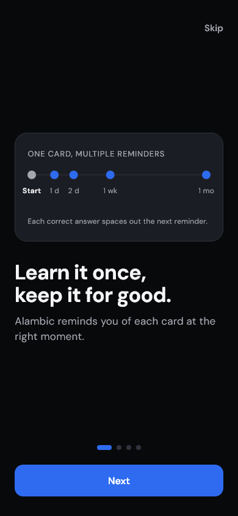
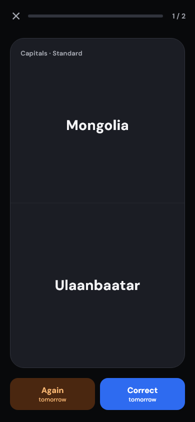
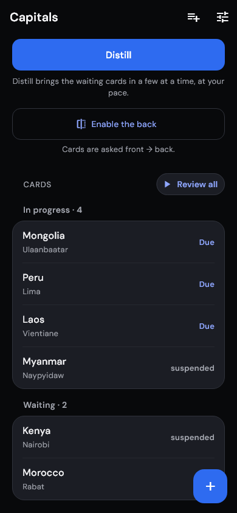

# Alambic

<div align="center">
    
</div>

A notification-first spaced repetition app for Android: distill your knowledge by introducing new cards a few at a time. Most reviews happen straight from the notification.

<div align="center">
    
    
    
</div>

> **Alpha:** under active development. Features may change or break, and data may be reset between versions.

## Installation

Requirements: 
- Flutter 3.50
- Android SDK with platform 37

1. Pair & connect device:

   ```bash
   adb pair <ip>:<pairing-port>
   adb connect <ip>:<port>
   ```

2. Build and install:

   ```bash
   flutter build apk --release
   flutter install --release
   ```

The release build is signed with the debug key, so it installs over a debug build and keeps the app's data.

## Usage example: learning capitals

1. You can either use the default onboarding group, or create the group yourself: in the Groups tab, tap "New" and name the group "Capitals".
2. In the group, tap "Bulk add" in the toolbar and paste one card per line, front and back separated by `;`:

   ```text
   Capital of Chile ; Santiago
   Capital of Kenya ; Nairobi
   ```

3. New cards wait in the queue of the group until it distills them: tap "Distill", then each card arrives at the reminder time. With the Standard preset, it then comes back after 1 day, 2 days, 1 week, 1 month, 3 months and 6 months as long as it is answered correctly.

## Development

### Hot reload

Start the app once in debug mode on the connected device:

```bash
flutter run
```

Then, while it runs:

- `r`: hot reload, applies code changes in about a second and keeps the current screen and state. VS Code does it on every save.
- `R`: hot restart, restarts the app without rebuilding. Needed for changes to `static final` values, `main()` or app initialization.
- `q`: quit.

After a drift schema change, run `dart run build_runner build`, then hot restart.

### More

Commands, conventions and known pitfalls: [docs/stack.md](docs/stack.md). Architecture: [docs/architecture.md](docs/architecture.md).
